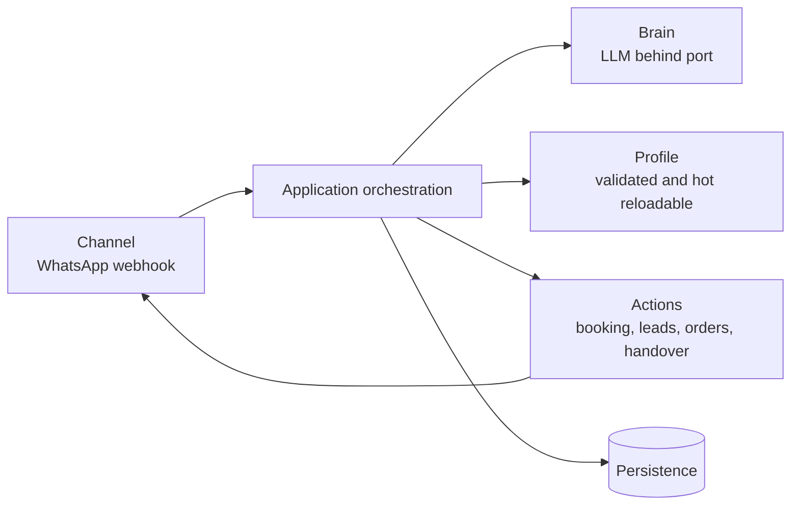
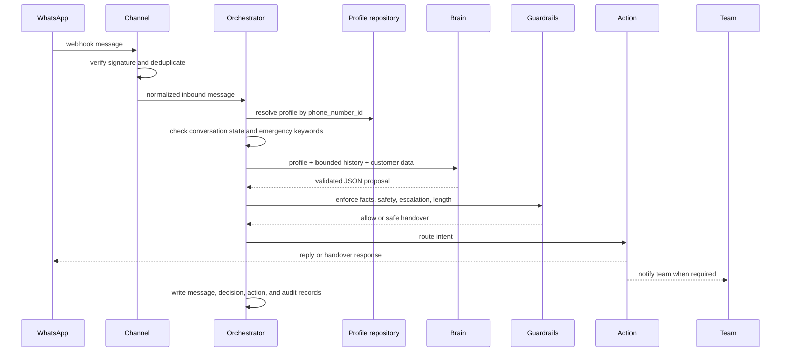

# Snappe.ai architecture

Snappe.ai is a reusable auto-replier. A new client supplies a validated profile;
business behavior is not implemented as client-specific code.

## Layers

The channel verifies and normalizes inbound data. The application layer owns
ordering, deduplication, state transitions, guardrails, and audit decisions.
The brain proposes a strictly validated response; code-enforced guardrails
decide whether it may be sent. Actions are ports with replaceable adapters.

## Runtime flow

## Boundaries

`snappe.domain` contains business concepts and rules. `snappe.application`
contains use cases and Protocol ports. `snappe.adapters` contains FastAPI,
WhatsApp, LLM, persistence, calendar, and scheduler implementations. Dependency
direction points inward; import-linter contracts enforce this boundary.

## Deployment

Phase 0 targets Render with a single FastAPI process and SQLite for local and
early deployment. The persistence port keeps a Postgres path open for scale.
The initial queue is in-process; a durable broker and worker pool can replace it
without changing domain use cases.
